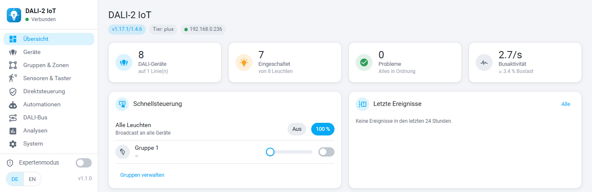
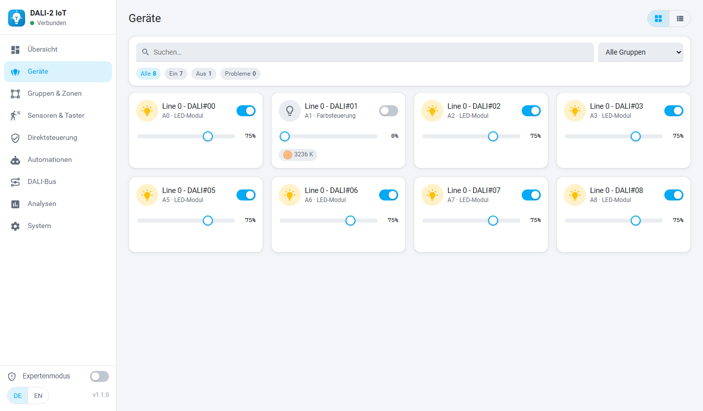
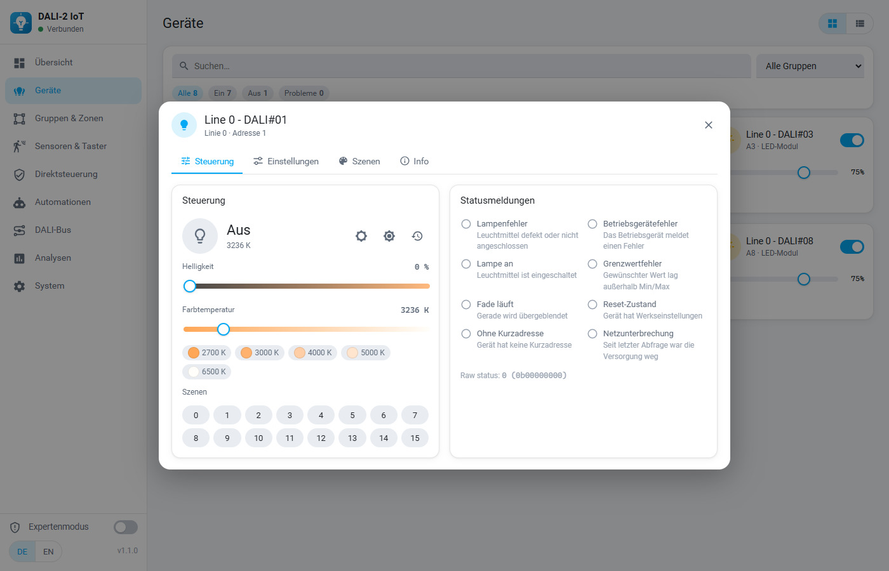
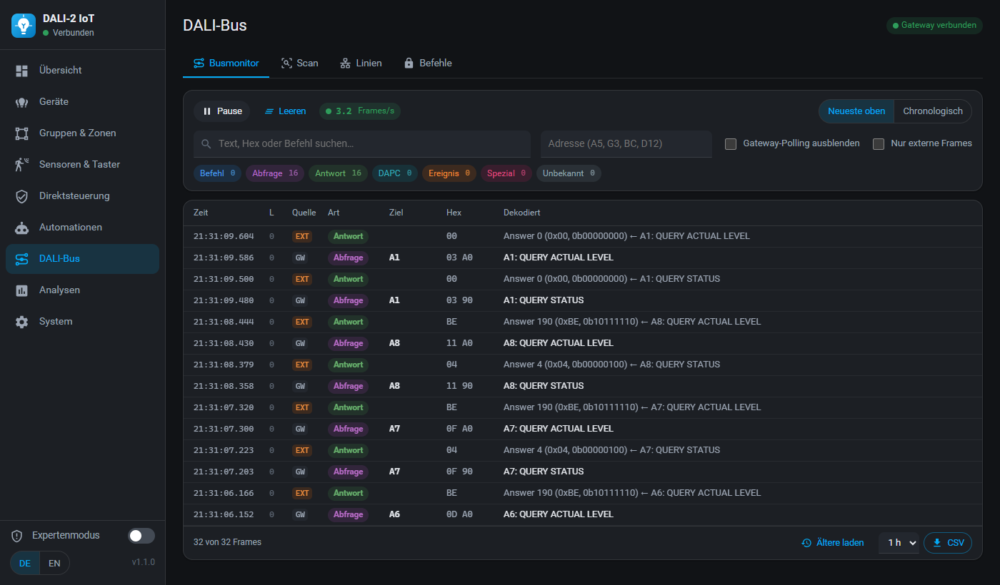
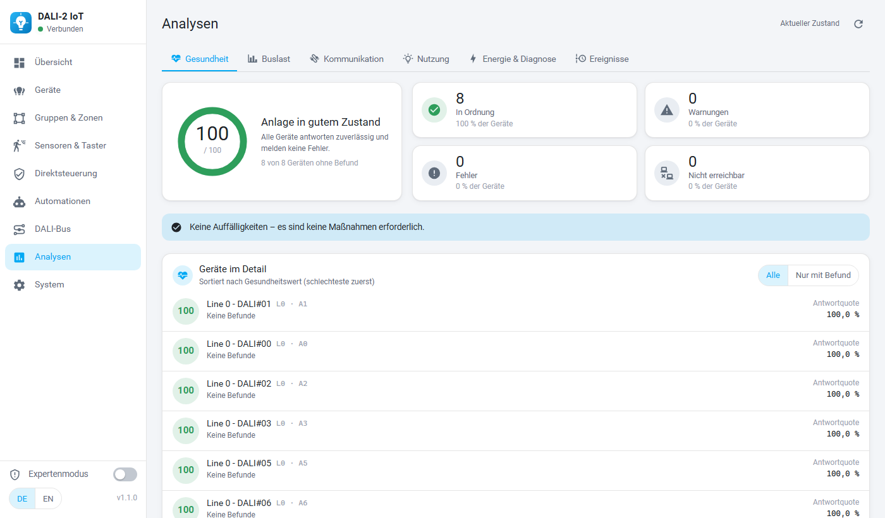
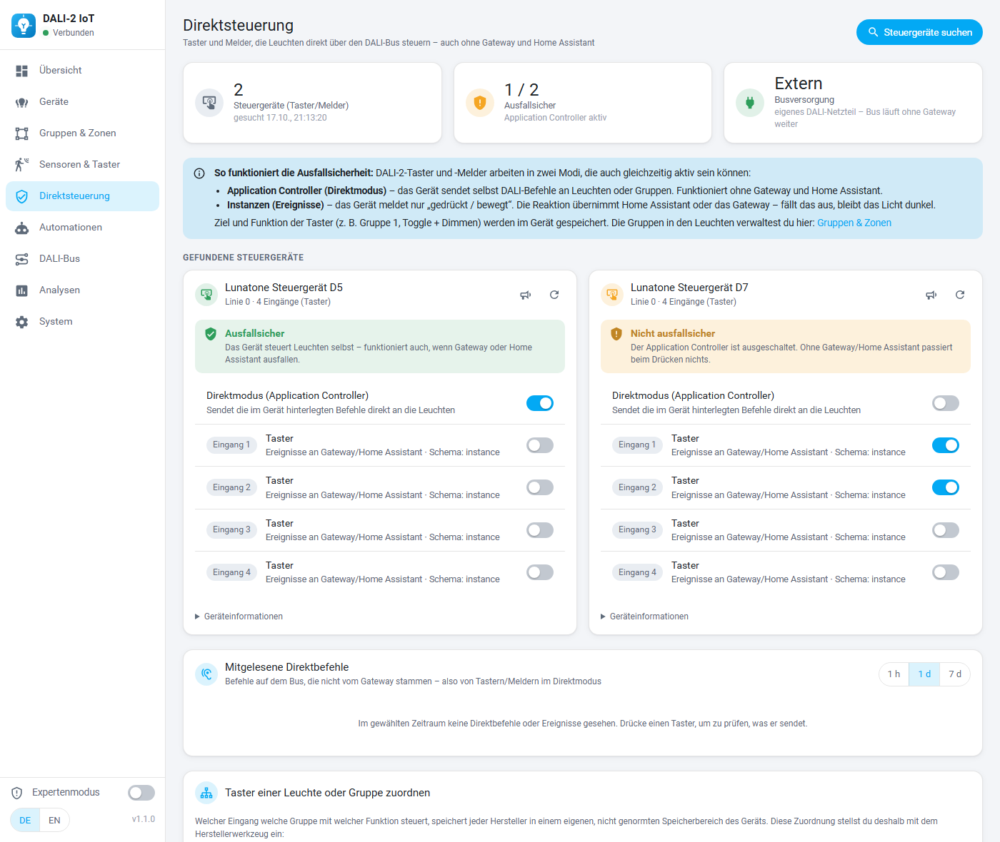

<p align="center">
  
</p>

<h1 align="center">DALI-2 IoT Manager</h1>

<p align="center">
  DALI-2-Lichtsteuerung für Home Assistant: Add-on mit kompletter Verwaltungsoberfläche<br>
  + Integration mit Auto-Discovery aller DALI-Teilnehmer
</p>

<p align="center">
  <a href="https://my.home-assistant.io/redirect/supervisor_add_addon_repository/?repository_url=https%3A%2F%2Fgithub.com%2FGloecki2404%2FDALI2-IoT-Manager"></a>
  &nbsp;
  <a href="https://my.home-assistant.io/redirect/hacs_repository/?owner=Gloecki2404&repository=DALI2-IoT-Manager&category=integration"></a>
</p>

---



## Unterstützte Gateways

| Gateway | Status |
|---------|--------|
| Lunatone DALI-2 IoT (Firmware v1.17.1/1.4.6) | ✅ getestet |

Weitere DALI-2-Gateways können später ergänzt werden.

## Was ist enthalten?

| Teil | Wofür |
|------|-------|
| **Add-on „DALI-2 IoT Manager“** (`dali2_iot_manager/`) | Eigene Oberfläche in der HA-Seitenleiste für alle Einstellungen, den Busmonitor und Analysen – im HA-Design, hell/dunkel, Deutsch/Englisch, auch am Handy |
| **Integration „DALI-2 IoT Manager“** (`custom_components/dali2_iot/`) | Stellt alle DALI-Teilnehmer automatisch als Entitäten bereit – Leuchten, Gruppen, Sensoren, Taster/Melder, Energie & Diagnose, Gateway-Status |

Beide Teile funktionieren unabhängig voneinander. Zusammen meldet das Add-on das Gateway automatisch an die Integration („Entdeckt“ unter *Geräte & Dienste*).

## Funktionen

### Add-on (Verwaltungsoberfläche)

- **Geräte** – Leuchten schalten, dimmen, Farbtemperatur/RGB, Name, DALI-Gruppen, Fadezeit/-rate, Szenen 0–15, DALI-Parameter (Min/Max, Einschalt- und Notlicht-Level) direkt aus dem Betriebsgerät, Identifizieren
- **Gruppen & Zonen** – Gruppen-Matrix (Geräte × 16 Gruppen) mit einem Klick, Zonen anlegen und steuern
- **Direktsteuerung** – prüft, ob Taster und Melder die Leuchten **selbst über den Bus** steuern (funktioniert auch, wenn Gateway oder Home Assistant ausfallen), schaltet den Application Controller und stellt alle genormten Einstellungen der Taster und Melder ein (Zeiten, Ereignisfilter, Schema, Priorität, Gruppen, Kurzadresse – wie DALI Cockpit), mitgelesene Direktbefehle
- **Sensoren & Taster** – Gateway-Sensoren mit Verlauf, automatisch gelernte DALI-2-Eingänge
- **Automationen** – die Automationen, die direkt im Gateway laufen: Sequenzen, Zeitpläne (auch Sonnenauf-/-untergang), Circadian-Lichtverläufe, Trigger-Aktionen, Event-Weiterleitung, Statusabfragen
- **DALI-Bus** – Live-Busmonitor mit Klartext-Dekodierung nach IEC 62386, Filter, CSV-Export, DALI-Scan, Linienstatus, Rohbefehle (Expertenmodus)
- **Analysen** – Gesundheitsbericht, Buslast, Kommunikationsqualität je Adresse, Einschaltdauer & Schaltzyklen, Energie & Diagnose (D4i), Ereignisprotokoll
- **System** – Name, Datum/Zeitzone, Standort, Einstellungen, Sicherung & Wiederherstellung, Neustart
- **Expertenbereich** – Netzwerk, Firmware-Update, DALI-Makros, Löschen, Werksreset – nur mit Expertenmodus und doppelter Bestätigung

### Integration (Entitäten)

- `light.*` für jedes Betriebsgerät und jede belegte DALI-Gruppe (Helligkeit, Farbtemperatur, RGB/XY, Überblendung; „Einschalten“ stellt den letzten Wert wieder her)
- Status live über den WebSocket des Gateways (kein ständiges Abfragen)
- Diagnose-Sensoren je Leuchte: Lampenfehler, Betriebsgerätefehler, Erreichbar, …
- Gateway-Sensoren: Präsenz, Helligkeit, Temperatur, Feuchte, CO₂, VOC …
- Leuchten werden über ihre Seriennummer (GTIN + Identifikationsnummer) erkannt – Entitäten und Automationen bleiben erhalten, wenn ein DALI-Scan neue Adressen vergibt
- DALI-2-Taster und -Melder werden gesucht und automatisch gelernt → `event.*`-Entitäten und Geräte-Auslöser im Automations-Editor, Anzeige „Ausfallsichere Direktsteuerung“ je Gerät
- Level bei Busausfall / nach Netzwiederkehr als Attribute, setzbar über `dali2_iot.set_failsafe_levels`
- Energie (DT51, fürs Energie-Dashboard) und Diagnose (DT52), falls die Geräte das können
- Aktionen: Szene aufrufen/speichern, heller/dunkler, Fadezeit, rohe DALI-Befehle, DALI-Scan, …

## Screenshots

| Geräte | Gerätedialog |
|---|---|
|  |  |

| Busmonitor (Dark Mode) | Gesundheitsbericht |
|---|---|
|  |  |

**Direktsteuerung** (Beispielansicht mit zwei simulierten Tasterkopplern):



## Installation

Voraussetzungen: Home Assistant OS oder Supervised (für das Add-on), Home Assistant 2025.1 oder neuer, ein Lunatone DALI-2 IoT im selben Netzwerk.

### 1. Add-on

1. Auf den Button **„Add-on-Repository hinzufügen“** oben klicken – oder in Home Assistant *Einstellungen → Add-ons → Add-on-Store → ⋮ → Repositories* und diese URL eintragen:
   ```
   https://github.com/Gloecki2404/DALI2-IoT-Manager
   ```
2. **DALI-2 IoT Manager** installieren (das Image wird lokal gebaut, ca. 1–3 Minuten) und starten.
3. Optional in der Add-on-Konfiguration die IP des Gateways eintragen – leer lassen = automatische Suche im Netzwerk.
4. *In Seitenleiste anzeigen* aktivieren → Menüpunkt **DALI-2 IoT**.

### 2. Integration (über HACS)

1. Auf den Button **„In HACS öffnen“** oben klicken – oder in HACS *⋮ → Benutzerdefinierte Repositories* die URL von oben mit Typ **Integration** hinzufügen.
2. **DALI-2 IoT Manager** herunterladen und Home Assistant neu starten.
3. Unter *Einstellungen → Geräte & Dienste* erscheint das Gateway als **Entdeckt** (vom Add-on gemeldet) → *Konfigurieren*.
   Ohne Add-on: *Integration hinzufügen* → „DALI-2 IoT Manager“ → *Netzwerk durchsuchen* oder IP eingeben.

Ohne HACS: den Ordner `custom_components/dali2_iot` nach `/config/custom_components/` kopieren und HA neu starten. Eine Anleitung für die Installation ohne GitHub (ZIP/Samba) steht in [INSTALL.md](INSTALL.md).

## Updates

- **Add-on:** Sobald hier eine neue Version veröffentlicht ist, zeigt Home Assistant das Update im Add-on-Store bzw. unter *Einstellungen → Updates* an – ein Klick auf *Aktualisieren* genügt.
- **Integration:** HACS meldet neue Versionen unter *Einstellungen → Updates*; nach dem Update HA neu starten.
- Was sich geändert hat: [CHANGELOG des Add-ons](dali2_iot_manager/CHANGELOG.md)

## Ausfallsichere Taster (Direktsteuerung)

Damit das Licht auch funktioniert, wenn das Gateway oder Home Assistant ausfällt, muss die Logik im Taster selbst liegen (**Application Controller** des Tasterkopplers, z. B. Lunatone DALI-2 MC *-2-app*) und der Bus ein **eigenes DALI-Netzteil** haben. Das Add-on prüft beides im Reiter *Direktsteuerung* und schaltet den Application Controller nach IEC 62386-103.

Welche Gruppe welcher Taster mit welcher Funktion steuert, speichert jeder Hersteller in einem eigenen, nicht genormten Speicherbereich – diese Zuordnung wird mit dem Herstellerwerkzeug eingestellt (Lunatone: *DALI Cockpit* über das IoT-Gateway oder die NFC-App).

Außerdem legt jede Leuchte selbst fest, was sie bei **Busausfall** und nach **Netzwiederkehr** tut (Standard meist 100 %). Beides lässt sich im Reiter *Direktsteuerung* für alle Leuchten prüfen und setzen.

## Hinweise

- Die offizielle HA-Integration **„Lunatone“** nicht zusätzlich für dasselbe Gateway verwenden (doppelte Entitäten).
- Das Gateway meldet die **Farbtemperatur** bei manchen DT8-Leuchten nicht zurück – die Integration zeigt dann den zuletzt gesendeten Wert.
- Ab Werk steht das Gateway oft auf der Zeitzone **UTC** – das Add-on zeigt unter *System* einen Hinweis und übernimmt auf Wunsch die HA-Zeitzone (wichtig für Zeitpläne).
- Eine feste IP-Adresse (DHCP-Reservierung) für das Gateway ist empfehlenswert.
- Ein **DALI-Scan** kann Geräten neue Kurzadressen geben, auch ohne Neuinstallation. Das Add-on sichert die Gerätenamen vorher und stellt sie danach wieder her; die Integration ordnet Leuchten über ihre Seriennummer zu.
- Dies ist ein privates Projekt und steht in keiner Verbindung zur Lunatone Industrielle Elektronik GmbH.

## Entwicklung

```bash
# Frontend (Vue 3 + Vite) – baut nach dali2_iot_manager/www
cd frontend && npm install && npm run build
# Add-on-Backend lokal gegen ein Gateway starten (ohne Supervisor)
cd dali2_iot_manager/app && GATEWAY_HOST=<gateway-ip> DATA_DIR=/tmp/lunatone python main.py
# Tests (Linux/WSL, Python >= 3.13)
pip install pytest-homeassistant-custom-component && pytest tests dali2_iot_manager/tests
```

Projektstruktur: `dali2_iot_manager/` (Add-on), `custom_components/dali2_iot/` (Integration), `frontend/` (Quellcode der Oberfläche), `tests/`, `tools/` (Übersetzungen, Icons).

## Lizenz

[MIT](LICENSE) © 2026 Gloecki2404. Die Lizenzen der mitgelieferten Bibliotheken (Vue, Vue Router, Chart.js, Material Design Icons) stehen in [THIRD_PARTY_NOTICES.md](dali2_iot_manager/THIRD_PARTY_NOTICES.md).
